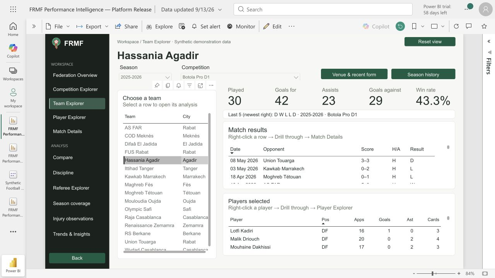

# FRMF Performance Intelligence

Football analytics developed for my fourth-year engineering internship at the Royal Moroccan Football Federation. The project combines Power BI reports with a local assistant that queries football data through read-only SQLite.



## Project

- [Power BI report](powerbi/report.pbix): competition, team, player and match analysis, comparisons, discipline and coverage.
- [Local assistant](assistant/): natural-language questions, calculated result tables and inspectable query evidence.
- [Synthetic dataset](data/synthetic/): 21 CSV tables covering six seasons and six competitions, with 3,950 fixtures and 3,352 played matches.
- [Final report](docs/report.pdf) and [presentation](docs/presentation.pdf).

The demonstration records are fictional, including performances associated with familiar club names. The original federation extract, credentials and model weights are excluded.

## Run locally

Requires Node.js 22+, Python 3.11+ with SQLite support, and a separately installed Ollama model. There are no npm dependencies to install.

```sh
npm run model
```

With the model installed in that runtime, start the application in another terminal:

```sh
npm start
```

Open <http://127.0.0.1:8765/>. See [setup](docs/setup.md) for the model runtime and configuration. The application prepares its synthetic snapshot before starting.

```sh
npm test
```

Tests exercise application contracts and real SQLite calculations with simulated model responses. They are separate from model accuracy evaluation.

## Status

The Power BI demonstration and local assistant were completed, verified on defined synthetic cases and handed over to the federation engineer. Institutional data integration and shared local-network deployment remained unfinished at internship closure. Power BI Desktop refresh on federation hardware is still unverified.

The assistant runs as a separate website. It uses its own filters and SQLite snapshot, without reading the report's DAX model or automatically receiving Power BI slicer selections.

The initial source-import pipeline remains in `src/` and `sql/`. It requires an authorized source extract and is separate from the included synthetic demonstration. [Metric definitions](docs/metrics.md) describe the analytical rules.

Karim AKOUDAD · International University of Rabat
